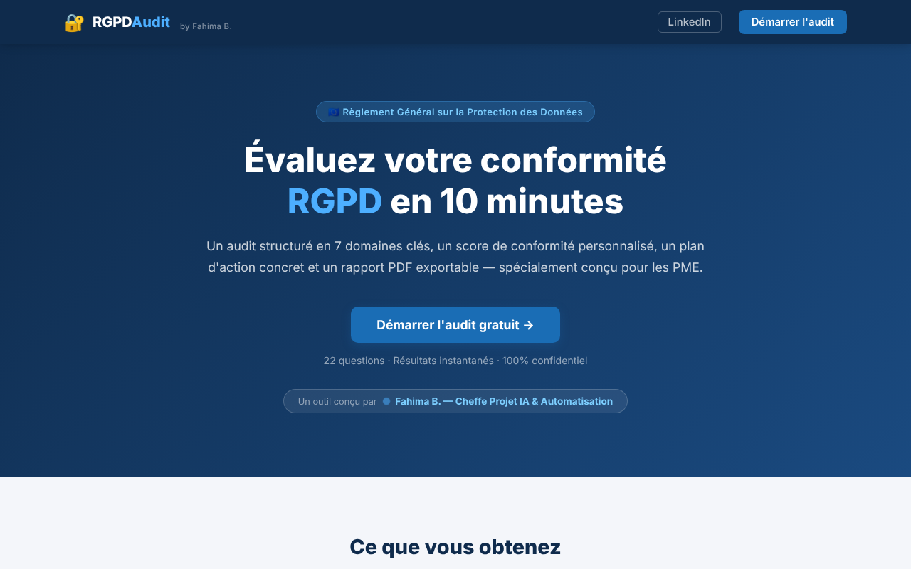
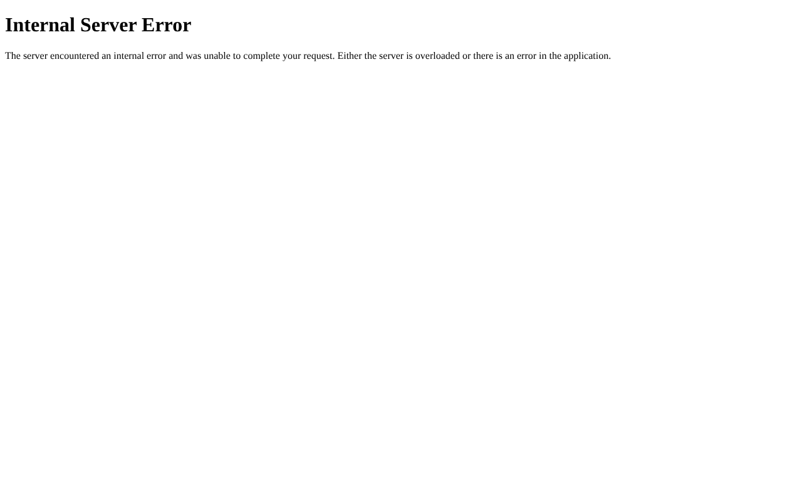
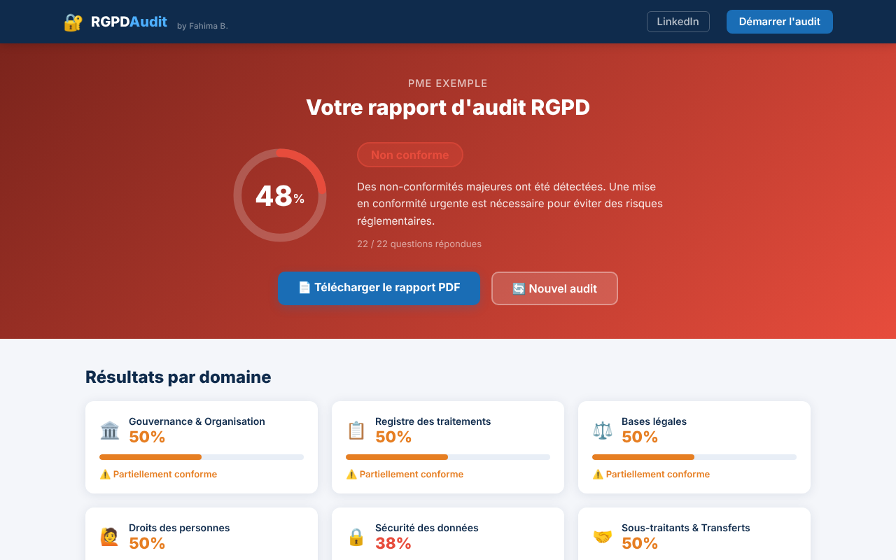

# 🔐 RGPDAudit : l'audit de conformité RGPD pour les PME


> **Le problème :** une PME sait qu'elle « doit faire du RGPD », mais ne sait ni où elle en est ni par quoi commencer. Un audit par un cabinet coûte cher, et un PDF de la CNIL ne dit pas *quoi faire lundi matin*.
> **La solution :** 22 questions, 10 minutes, un score par domaine et un **plan d'action priorisé**, exportable en PDF.



---

## ⚙️ Comment ça marche

1. **Questionnaire** : 22 questions réparties en 7 domaines, rédigées pour un dirigeant non juriste
2. **Score pondéré** : chaque domaine pèse selon son risque réel (la sécurité compte plus que la formation)
3. **Plan d'action** : chaque écart génère une recommandation concrète, triée par priorité (haute / moyenne / faible) puis par ampleur de l'écart
4. **Rapport PDF** prêt à partager avec la direction ou un DPO

| Domaine | Poids | Exemples de points contrôlés |
|---|---|---|
| 🔒 Sécurité des données | **1,5** | Chiffrement, moindre privilège, sauvegardes testées, 2FA |
| ⚖️ Bases légales | 1,3 | Base légale de chaque traitement, consentement, opt-in marketing |
| 📋 Registre des traitements | 1,2 | Registre article 30, durées de conservation, AIPD |
| 🙋 Droits des personnes | 1,2 | Information des personnes, procédure d'exercice des droits, contact dédié |
| 🤝 Sous-traitants & transferts | 1,1 | Contrats de sous-traitance (DPA), conformité des prestataires, cloud hors UE |
| 🏛️ Gouvernance & organisation | 1,0 | Référent RGPD ou DPO, sensibilisation, politique interne |
| 🚨 Violations de données | 1,0 | Procédure de notification à la CNIL, registre des violations, circuit de signalement |

**Lecture du score :** ≥ 75 % conforme · 50 à 74 % partiellement conforme · < 50 % non conforme.

## 📸 Aperçu

| Questionnaire | Résultats |
|---|---|
|  |  |

## 🔒 Confidentialité par conception

L'outil applique ce qu'il audite : **aucune base de données, aucun compte, aucun traceur.** Les réponses vivent uniquement dans la session du navigateur et disparaissent en fin d'audit.

## 🚀 Lancer en local

```bash
git clone https://github.com/Fahima94/audit-rgpd-pme.git
cd audit-rgpd-pme
pip install -r requirements.txt
python app.py            # http://localhost:5000
```

## 🗂️ Structure

```
app.py          → routes Flask + calcul des scores pondérés
questions.py    → référentiel : 7 domaines, 22 questions, recommandations
pdf_report.py   → génération du rapport PDF (ReportLab)
templates/      → accueil, questionnaire, résultats
static/         → styles et progression du questionnaire
```

## 🧭 Pistes d'évolution

- Déploiement cloud (GCP) pour un accès en ligne
- Volet **AI Act** pour les PME qui utilisent de l'IA
- Mode « consultant » : suivi de plusieurs clients et comparaison dans le temps

## 💡 Ce que ce projet montre

Transformer une **réglementation complexe en outil actionnable** pour un public non expert. C'est le cœur de mon métier : faire le pont entre le business, le juridique et la tech.

---

<div align="center">

**Fahima Behillil** · Cheffe de projet IA & Automatisation · *Business Tech Bridge*

[LinkedIn](https://www.linkedin.com/in/fahima-be/) · [Prendre RDV (Horizons Datas)](https://calendly.com/horizonsdatas/30min) · [Tous mes projets](https://github.com/Fahima94)

</div>
